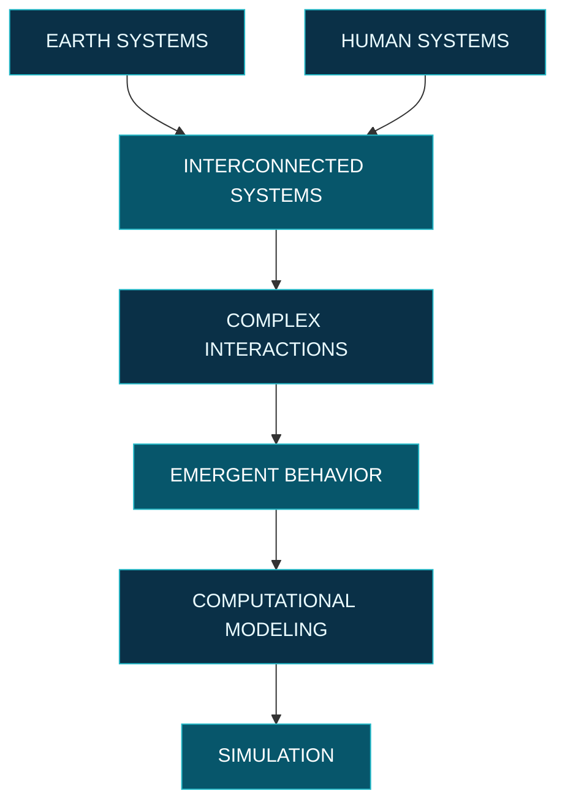

<!-- =====================================================
     ALAA MAHMOUD
     MIDNIGHT EARTH OBSERVATORY
====================================================== -->

 

# ALaa Mahmoud

**EARTH · DATA · COMPLEXITY**

 

  

<!-- EARTH AT NIGHT / NASA BLACK MARBLE -->

01 — EARTH OBSERVATION / HUMAN FOOTPRINT / SATELLITE DATA

 

---

### EARTH AS A CONNECTED SYSTEM

 

 

---

### COMPUTATIONAL RESEARCH

 

  

 

DATA ANALYSIS

  

GEOSPATIAL SCIENCE

  

MODELING & SIMULATION

 

---

### COMPLEXITY / EMERGENCE / INTERACTIONS

 

---

### RESEARCH LANDSCAPE

 

  

  

 

---

### GITHUB / ACTIVITY

  

 

---

### FIND ME

  

