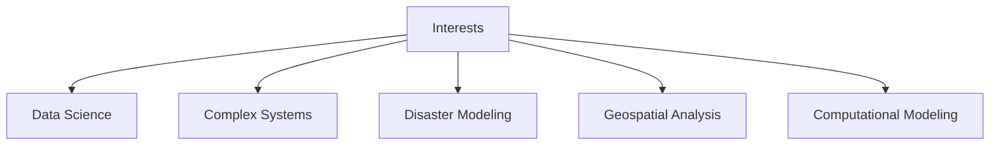
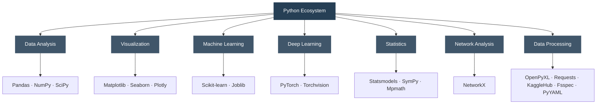

# Alaa Mahmoud

Data Science · Complex Systems · Disaster Modeling

---

### About

Interested in data, computational methods, and complex systems.

### Interests

### Tools & Technologies

### Development

`Python` · `Jupyter Notebook` · `VS Code` · `Git` · `GitHub`

---

Learning and exploring.

