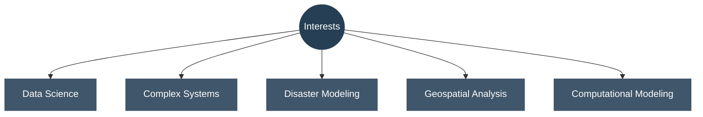
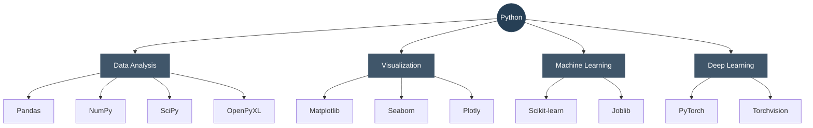
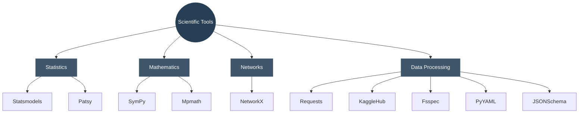

# Alaa Mahmoud

**Data Science · Complex Systems · Disaster Modeling**

---

### About

Interested in data science, computational methods, and understanding complex systems and real-world phenomena.

---

### Interests

---

### Tools & Technologies

---

### Development Environment

- 🐍 Python
- 📓 Jupyter Notebook
- 💻 VS Code
- 🔧 Git & GitHub

---

*Learning · Exploring · Creating*

