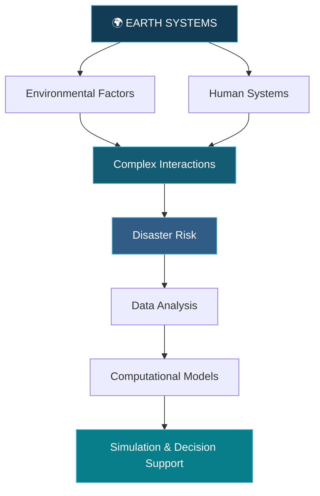

### Exploring the complexity of our world.

Data · Systems · Earth · Simulation

---

## ◉ THE SCIENTIFIC LANDSCAPE

## 🌍 AREAS OF EXPLORATION

<table>
<tr>
<td width="50%" align="center">

### 🌐 Earth Systems

Geospatial Analysis

Environmental Data

Spatial Patterns

</td>
<td width="50%" align="center">

### 🧩 Complex Systems

System Dynamics

Emergent Behavior

Human-Environment Interactions

</td>
</tr>
<tr>
<td width="50%" align="center">

### 🌪️ Disaster Modeling

Disaster Risk Analysis

Risk Assessment

Computational Modeling

</td>
<td width="50%" align="center">

### 🤖 Computational Science

Machine Learning

Agent-Based Modeling

Simulation

</td>
</tr>
</table>

## 🔬 SYSTEMS THINKING

## ⚙️ COMPUTATIONAL TOOLKIT

### Programming

### Data Science

### Geospatial & Simulation

### Development

## 📡 PROJECTS & EXPLORATIONS

<table>
<tr>
<td width="50%">

**01 / GLOBAL DISASTER DATA**

Historical disaster data analysis, temporal patterns, and statistical exploration.

</td>
<td width="50%">

**02 / GEOSPATIAL RISK**

Spatial analysis, geographic data, and disaster exposure mapping.

</td>
</tr>
<tr>
<td width="50%">

**03 / HUMAN BEHAVIOR**

Agent-based approaches to understanding human behavior during disasters.

</td>
<td width="50%">

**04 / COMPLEX SYSTEMS**

Computational modeling, simulation, and interconnected systems.

</td>
</tr>
</table>

## 📊 GITHUB ACTIVITY

---

### CONNECT

  

**OBSERVE · ANALYZE · MODEL · SIMULATE**

